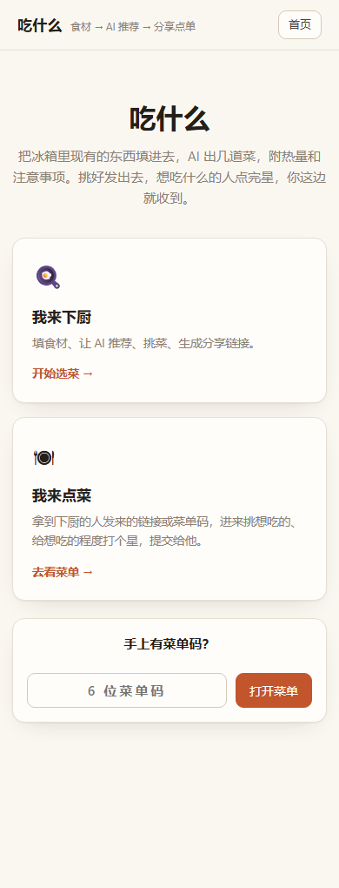
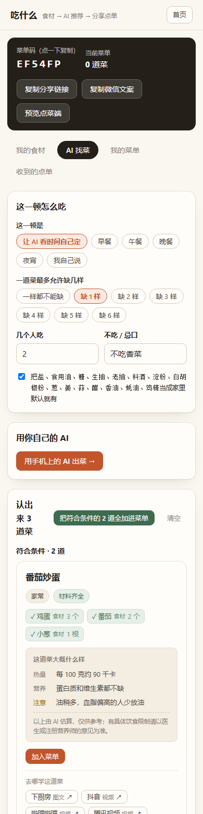

# 吃什么 · 回家做饭的菜单协作工具

打开冰箱，把现有的东西填进去，挑出今晚做哪几道；然后把菜单甩给要一起吃饭的人，
他们点完、给想吃的程度打个星，你这边就收到。

**解决的是分工问题**：谁做、谁吃、吃什么，这三件事在群里来回问十几条消息也定不下来。
这里把它压成一个 6 位菜单码。

纯静态前端，**零依赖、零构建**，不需要 `npm install`，不需要打包工具。
仓库根目录直接丢给任意静态托管就能跑。

<p align="center">
  
  
</p>

## 两种角色

一个站，两个入口，对着的是两种完全不同的人：

**下厨的人** —— 填家里现有的食材 → 挑菜 → 生成 6 位菜单码 → 发出去。
别人点单回传后，工作台顶部出现未读角标。

> **站里不调任何大模型。** 挑菜的提示词由页面按你填的食材和条件拼好、给你复制，
> 你拿到自己手机上的 AI 应用里跑一遍，再把结果粘回来 —— 算力是你自己的，
> 站点这边零成本、零密钥、也不会偷偷花掉搭建者的额度。

**点菜的人** —— 拿到那 6 位菜单码 → 进来挑想吃的 → 给每道菜打星 →
提交，或者留句话。菜单上没有的可以自己加。

角色不是账号，是**两把不同的钥匙**：

- `cook_token`：下厨的人的本机密钥，存在浏览器里。拿着它才能改菜单、读点单。
- `share_code`：公开菜单码，就是要发给别人的那个。拿着它**只能看到该给人看的部分**。

没有注册、没有登录、没有密码。点菜的人换个设备、输同一串菜单码，看到的还是同一份菜单。

## 目录结构

```
.
├── index.html              单页外壳：路由、PWA 清单、版本自检
├── manifest.json           「添加到主屏幕」用的清单
├── version.txt             构建号，用来解决"改了没生效"的缓存问题
├── assets/
│   ├── style.css           全部样式
│   ├── app.js              路由与启动
│   ├── ui.js               通用组件、toast、错误文案
│   ├── cloud.js            云端访问层（6 个 RPC 的唯一出口）
│   ├── cook.js             下厨端：食材 / 挑菜 / 菜单 / 收到点单
│   ├── guest.js            点菜端
│   ├── ai.js               拼提示词 / 解析粘回来的文本（**不联网**，见下）
│   ├── config.js           云服务端点与 publishable key ← 要换成你自己的
│   ├── vendor/wbcloud.js   云服务客户端 SDK（第三方，见 LICENSE）
│   └── *.png               图标
├── backend/
│   ├── schema.sql          两张表 + 索引 + RLS
│   ├── functions.sql       6 个服务端函数
│   └── README.md           安全模型说明
└── docs/                   README 用的截图
```

## 本地跑起来

没有构建步骤。任选一种：

```bash
# 方式一：起个静态服务（推荐）
python -m http.server 8080

# 方式二：直接双击 index.html
# 也能跑，但「添加到主屏幕」这类需要 http(s) 协议的能力会失效
```

打开 `http://localhost:8080`。

> ⚠️ **不改 `assets/config.js` 就直接跑，云端的读写会落到作者的实例上。**
> 页面能打开、能填食材、也能生成菜单码 —— 但那不是你的数据库。
> 想自己用，请看下面的「后端」。

## 后端

见 [`backend/README.md`](backend/README.md)。简单说：

- 两张表 + 6 个 `SECURITY DEFINER` 函数
- 表对浏览器完全关闭（RLS 开启且无 policy），读写只走函数
- 函数自己校验凭证，并且**只返回该给这个人看的东西**
- 前端里**没有任何密钥**（没有大模型 key、没有数据库密码）

要接自己的实例，改 `assets/config.js` 里的两个值：

```js
window.KF.config = {
  endpoint: '<你的云服务地址>',
  publishableKey: '<你的 publishable key>',
};
```

在 Supabase 上重建也行，`backend/` 里的 SQL 是标准 plpgsql。

## 几处刻意的设计

这些都是踩过坑之后改成的样子，改之前建议先看一眼原因。

**菜单码 32 个字符里没有 `I` `O` `0` `1`**
抄菜单码的时候不会把 0/O、1/I 认混。撞码会自动重摇，且有次数上限。

**分享只走 6 位菜单码这一条路**
不提供"复制分享链接"和"复制微信文案"。菜单码短，念一遍就能发出去，
对方在任意浏览器里输一次就进菜单；而分享链接是把 `location.origin`
焊死在一段可分享文本里的唯一一处 —— 换域名、换部署就全都失效，
收着旧链接的人只会看到打不开。一条路比三条路少两处会坏的地方。

**写操作全部有长度上限**
点单最多 60 道、留言 500 字、昵称 40 字。

**`kf_upsert_kitchen` 是部分更新**
用 `coalesce` 保留旧值 —— 否则前端只提交一个字段时会把其它字段清空。

**版本自检会自己刷新**
静态资源是按网址缓存的，同名文件改了内容不会自动更新。所以每次加载都会悄悄
问一次 `version.txt`，对不上就带新版本号重进 —— 用户不用手动强刷，
点菜的人也不用。这个坑在"你改了、对方看到的还是旧的"里特别难查。

**云服务 SDK 自己托管，不引境外 CDN**
原先引的是 `cdn.jsdelivr.net`，境外服务器在国内网络下经常连不上或要等十几秒，
SDK 一加载不出来就是白屏，表现成"链接打不开"。现在跟其它静态资源一样放在
自己的域名下。

**能不加后端的地方就不加**
自己的密钥、界面偏好这些全在浏览器本地；真正需要服务端的只有一件事
—— 把菜单发出去、让别人点完还能回传给你。所以后端就只有那 6 个函数。

**「换换口味」抽到的方向是钉住的**
提示词里会写「这次往『一锅出』这个方向想」。这个方向抽出后要记下来，
粘回来时沿用**同一个** —— 因为抽取逻辑天生要避开上一轮那个方向，
两端各抽一次的话，第二次抽到的必然是另一个，界面显示的「这一轮走的是 X」
就和用户手上那段提示词里写的对不上了。
同理，要是用户没走「复制提示词」这一步、直接把别处的回复粘进来，
手上根本没有我们的提示词，这时界面就退回「这一轮的花样」，
不替他编一个没收到过的方向。

## 数据与隐私

- 不收集任何用户数据，没有埋点，没有统计脚本。
- 你填的食材、菜单、点单存在数据库里，但**只能通过那 6 个函数访问**。
- `cook_token` 和 `guest_token` 只存在你自己的浏览器里，不上传、不互通。
- 清浏览器缓存会丢掉自己的 `cook_token`，等于丢掉对那份菜单的控制权
  —— 菜单码还在的话，别人仍能看到旧菜单，但你再也改不动它。

## 已知限制

- **清缓存丢身份。** 没有账号体系，`cook_token` 只在本机。这是"不用登录"的代价。
- **分享码 6 位是有上限的。** 32⁶ ≈ 10.7 亿，给"几个人一起吃饭"绰绰有余，
  但撑不住"全人类一起用"。撞满会升 7 位、8 位，再不行就报错。
- **菜的质量取决于你自己那个 AI。** 站里不调任何模型：提示词由 `assets/ai.js`
  拼好给你复制走，菜是你手机上的 AI 出的。菜谱链接来自公开搜索，不保证每条都能打开。

## 已经砍掉的东西

早期版本是「站内调一个零额度模型」，为了让它在国内网络下真正能发布，
下面这些已经删干净了（从老版本升级过来的话，不用再找它们）：

- **站内模型整条链路** —— `ai.js` 里的 `generate` / `generateSteps`、模型白名单、
  档位表、回退逻辑，以及只给站内调用用的那两段 system 提示词。
  现在**整个仓库没有任何一处会去调大模型**，因此也不存在"偷偷花掉谁额度"的可能。
- **菜品卡上的「让 AI 写做法」** —— 没有站内模型可调了，做法改在「编辑」里手写。
- **全站的说明性小字** —— 按「解释为什么 / 怎么运作的删掉，告诉你现在做什么的留下」
  这条线扫了一遍，`cook.js` 一个文件净减约 300 行。
- **首页的「想装到手机上？」与「微信里点链接打不开？」两张卡**，以及品牌栏的版本号。
- **「复制分享链接」与「复制微信文案」两个按钮**，以及菜单页里那个只读的分享链接输入框。
  分享收敛成一条路：只留「复制菜单码」。
- **整个 `android/` 目录**（下载页 + 1.0 APK + 二维码）。首页的入口撤掉之后它已经
  没有任何页面能到达，留着只是仓库里一块没人维护的死重。这条链路还留着
  早期提交里（`git log -- android/` 可查），要恢复随时能找回来。

### `assets/ai.js` 现在是什么

它**不联网**了，只干四件事：拼提示词（`ownPrompt`）、解析粘回来的文本
（`ingestExternal`）、判定"家里有没有"（`normalizeDish`）、生成菜谱搜索链接
（`tutorials` / `safeUrl`）。

⚠️ 但它**仍然不是自包含的**：`guest.js` 用到其中一个函数 `AI.safeUrl`
（点"打开菜谱来源"那一刻）。想把它拆走的话，先把这些纯工具挪到别的文件
（比如 `assets/ui.js` 或新建一个 `assets/dish.js`），改好两端的引用再删 ——
**直接删 `ai.js` 会让点菜端在"打开菜谱来源"时崩**，而不是打开页面就崩，很难第一时间发现。

## 许可

MIT，见 [`LICENSE`](LICENSE)。

`assets/vendor/wbcloud.js` 是第三方的云服务客户端 SDK，版权归其作者，
随仓库分发只是为了让站点能独立运行，不在 MIT 覆盖范围内。
